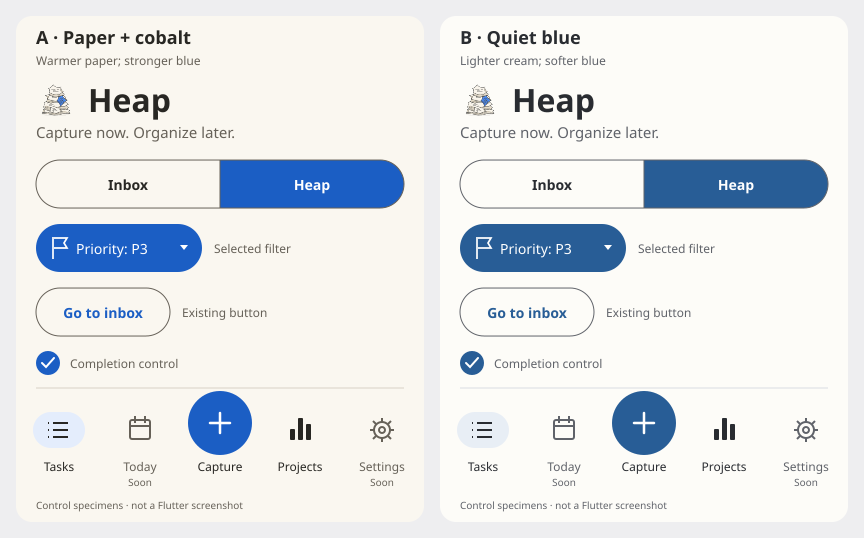

# Heap in-app brand refresh

Design proposals by Sol 6.1. Luna owns Flutter implementation. Barrett requested 3 separate theme directions in a local HTML preview, superseding the initial A/B comparison below. Open [the 3-theme HTML preview](themes/index.html) to compare Paper desk, Blueprint and Graphite across Inbox, Heap, Capture and Controls. It works locally without downloads. Barrett selected Paper desk; Luna applied it to the app. The other directions remain available for comparison. Keep the installed launcher icon and approved drawing unchanged.

## Header first

The mountain in `HeapBrand` (`ui/lib/heap_style.dart`) was replaced with `header-mark.png` before the theme change:

- Transparent, untinted, centered `contain` image in the existing **40×32 logical-pixel frame**. The cropped image occupies **29.46×32**; do not stretch it or apply a color filter.
- Preserve `Wrap`: spacing **12**, run spacing **8**, centered cross-axis alignment. Preserve **Heap**, font size **32**, weight **800**, and its current color token until palette approval.
- Preserve `ExcludeSemantics` around the decorative image; announce “Heap” once. Preserve caller layout, wrapping, navigation, and behavior.
- Luna copies/registers the PNG as a Flutter asset and removes the obsolete mountain painter. No new dependency is needed.

`header-mark.svg` is the approved `../icon-options/01-teetering-pile.svg` with only the opaque background rectangle removed, export dimensions set to **696×756**, and viewBox cropped to **78 78 348 378**. All paths, filters, fills, hatching, and ground line are unchanged. PNG is RGBA with transparent corners and unclipped artwork. The generous raster size supports high-density phones. Launcher masking does not apply to this in-app image.

## Applied Paper desk theme

The app uses warm cream and ivory surfaces, charcoal text, cobalt actions/focus,
and bundled Noto Serif Bold for screen, sheet, editor and dialog headings. The
Heap wordmark, task titles and body remain sans. P4 uses the approved plum;
completed rows use warm neutrals. Saved project colors, including green, are
unchanged. Font provenance and OFL license are in `ui/assets/fonts/`.

Verification: all 223 Flutter tests and analysis pass; debug/release APK and web
builds succeed. Emulator and Firefox checks covered real isolated API fixtures,
completion/undo, filters, capture/focus, project editing and saved green data,
including 320/2x Android text and 320px/200% web zoom. The release build was also
installed and opened on the Pixel 6 Pro; its Inbox showed the approved pile,
Paper desk colors and serif heading with live server data. Independent Luna code
review and Sol-6.1 visual review found no blockers. Barrett approved the installed
Pixel build.

## Earlier 2 palette options (superseded)

A **Paper + cobalt** uses the artwork's warm cream and a stronger blue. B **Quiet blue** uses lighter cream and a softer blue. I lean toward A because it stays closer to the approved paper. Neither is selected.

The comparison uses existing controls and labels: Inbox/Heap selector, selected `Priority: P3` filter, `Go to inbox`, completion check, and the current Tasks/Today/Capture/Projects/Settings toolbar. “Soon” remains on Today and Settings. These are separate control specimens, not a proposed task list or a Flutter screenshot; icons/font rendering are approximate.

### Proposed tokens

Hex values are design choices: blue comes from the note; cream and charcoal come from the paper and graphite. The button blues are deliberately darker than the raw note.

| Role / current touchpoint | A | B |
|---|---|---|
| Canvas / `heapCanvas`, scaffold, app bar, toolbar | `#FAF7F0` | `#FDFCF8` |
| Primary / current `heapGreen`, theme seed, focus, completion | `#1B5EC4` | `#285D96` |
| On-primary / selected filter, button, check | `#FFFFFF` | `#FFFFFF` |
| Ink + title / `heapInk`, `heapTitle`, wordmark | `#282723` | `#292C31` |
| Muted / `heapMuted`, secondary copy, unavailable navigation | `#666158` | `#60636A` |
| Selection / `heapHighlight`, hover, selected navigation | `#E4EDFC` | `#E8EEF5` |
| Decorative divider / `heapDivider` | `#D8D1C5` | `#D9DCE2` |
| Control outline / unselected control boundaries | `#666158` | `#60636A` |
| Completed + neutral pill fill | `#EBE7DF` | `#EDEEF0` |
| Completed + neutral pill text | `#49463F` | `#494D54` |
| Neutral priority dot | `#7C776D` | `#747981` |
| Input fill | `#FFFFFF` | `#FFFFFF` |

Completed secondary text uses the proposed muted token, not the existing green-gray hardcoded values. Use the neutral pill colors for P5 and Unset. Keep pale dividers decorative; use the darker control outline for boundaries that identify controls. Focus outlines use primary, never divider or selection fill.

### Contrast checks

Calculated with WCAG sRGB relative luminance, opaque colors, rounded to 2 decimals. Text pairs below meet **4.5:1**; focus outlines also exceed **3:1**.

| Foreground / background | A | B |
|---|---:|---:|
| White / primary | 6.10:1 | 6.78:1 |
| Ink / canvas | 13.97:1 | 13.65:1 |
| Muted / canvas | 5.75:1 | 5.86:1 |
| Ink / selection | 12.68:1 | 12.00:1 |
| Primary / selection | 5.17:1 | 5.81:1 |
| Muted / selection | 5.22:1 | 5.15:1 |
| Primary focus outline / canvas | 5.70:1 | 6.61:1 |
| Completed text / completed fill | 7.63:1 | 7.31:1 |
| Muted / completed fill | 4.99:1 | 5.18:1 |

The raw note blue `#2478EB` gives only **4.23:1** against white: keep it in the artwork, not white-label controls. Pale selection fills are not focus indicators; retain selected semantics and check selected states visually in Flutter. These calculations do not verify generated Material state overlays.

## Semantics and scope

Priority colors communicate priority, not brand. Preserve P1 red, P2 amber, and P3 blue. P4 is currently olive; both proposals suggest a muted plum **fill `#EEE5F3`, text `#624270`, dot `#8B6A9C`** to remove that remaining default olive accent (label/fill **6.77:1**). This is a proposal, not permission to recolor it independently. Keep the exact labels and meanings: **P1 Critical, P2 Important, P3 Normal, P4 Someday, P5 Maybe**, and **Unset**. Do not alter ordering, filtering, eligibility, or completion behavior.

Saved user-selected project green is user data, not the default brand palette. Leave saved project colors and choices unchanged unless Barrett explicitly decides otherwise. Preserve semantic error/warning colors; a blue primary must not turn errors into brand-blue messages.

## Luna's touchpoints after approval

- `heap_style.dart`: brand, shared tokens, approved priority/neutral pill changes.
- `main.dart`: replace green theme seed/primary; check all generated secondary, tertiary, surface-container, outline, input-focus, slider, menu, dialog, and state-overlay colors. Default surfaces/text must be cream/charcoal or blue, not green-tinted.
- `inbox_page.dart`, `heap_filter_pills.dart`, `task_toolbar.dart`: selector/filter fills, capture button, selected navigation, divider.
- `task_widgets.dart`: primary focus and completion; replace hardcoded completed green-gray title, metadata, blocked-pill text/fill with proposed neutrals.
- `project_widgets.dart`, `project_icon_browser.dart`: default focus, selection, and controls; preserve stored project colors.

## Checks before calling it done

Header-only: physical phone and emulator at normal and enlarged text; narrow width/wrapping, no clipping or cream rectangle, readable untinted blue note, 1 spoken “Heap”. Web: narrow and wide layouts, asset loading, browser zoom.

After palette approval: phone/emulator screenshots plus narrow/wide web; active/inactive filters and navigation, capture/edit dialogs, keyboard focus/hover, completion/pending/undo, priority pills, errors, and saved green projects. Check actual Material overlays and control borders, keep current 48px touch targets and toolbar wrapping. No device, Flutter, or browser behavior verification has been performed for these design files.

Sources: the 4 adjacent SVG/PNG files. PNGs were rendered with installed filter-capable librsvg/GdkPixbuf using the existing exporter library; no new generator tooling was added. Only `docs/heap-brand-refresh/` is owned by this design work.
