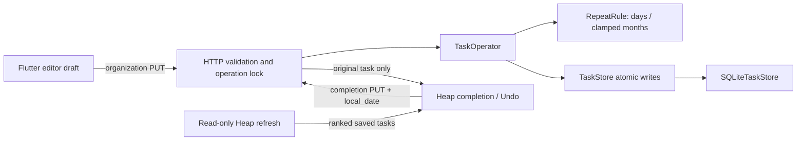

# Completion-based repeating tasks

## Scope

Implement spec section 9.1 using the existing task editor, completion control,
Python operations, and SQLite storage. Repeat every positive whole N days or
N months from the completing device's local calendar date. Keep calendar rules,
contexts, skip commands, series editors, and new history pages out of this change.

Barrett approved the behavior and authorized implementation, final review, and
a pull request. Worktree: `/home/barrett-lowe/PersonalDev/Heap-repeating-tasks`,
branch `feat/repeating-tasks`. Preserve unrelated uncommitted branding work in
`Heap`; do not include it in this branch or install over the hosted phone beta.

## Structure

Use task-owned repeat settings and a link from each completed occurrence to its
successor. This is smaller than a separate series/template table and avoids a
durable pending-generation state. Completed task snapshots supply history.



- `logic/recurrence.py`: `RepeatUnit` and immutable `RepeatRule(unit, interval)`.
  Validate units and positive whole intervals in the domain as well as HTTP.
  `next_due_date(completed_on: date) -> date` owns calendar arithmetic and raises
  a specific validation error for unrepresentable results.
- `logic/task.py`: nullable `repeat` settings; internal nullable
  `successor_id` and `successor_created_updated_at` on completed predecessors.
  These bookkeeping fields are not user-editable or public JSON.
- `TaskOperator.organize_task(..., repeat: RepeatRule | None, ...)`: edit repeat
  atomically with existing fields, preserving the first due date and Heap age.
  Existing field setters must preserve repeat/bookkeeping.
- `TaskOperator.complete(..., local_date: date | None = None)` and
  `complete_on_heap(..., local_date: date | None = None)`: repeating transitions
  require an explicit local date; nonrepeating Python callers need no change.
  Build completed predecessor and successor in Python; use `save_many` for 1
  transaction. Keep existing no-op behavior and monotonic comparison tokens.
- `TaskOperator.undo_completion(task_id)`: validate the saved successor ID,
  unfinished status, initial comparison token, and absence of dependency links
  in either direction. Reject missing successors as deliberate later changes.
  Restore the predecessor and delete the successor atomically. Clear predecessor
  successor bookkeeping on successful Undo; retain repeat and original Heap age.
- `TaskStore`: add the smallest atomic save/delete operation needed for Undo and
  a dependency-link involvement query. Keep business decisions out of SQL.
- `SQLiteTaskStore`: persist repeat and successor bookkeeping on every read/write
  path. Use existing transaction style. No new database service or scheduler.
  Do not build migration/legacy compatibility machinery; follow the existing
  small nullable-column initialization only where needed for the current store.

An incoming dependency link must prevent Undo even though adding it updates the
other task's timestamp. Removed incoming links need not block forever: if no
links remain and the successor itself is unchanged, Undo loses no saved work.
Completed history deletion must not cascade into an independent successor.

## Frozen HTTP additions

Public task metadata uses required nullable `repeat`:

```json
{"repeat": {"unit": "months", "interval": "1"}}
```

`null` means Off; `unit` is exactly `days` or `months`; `interval` is canonical
positive decimal text matching `[1-9][0-9]*`. Reject missing/extra nested fields,
JSON numbers (integer/float/exponent tokens), booleans, signs, whitespace,
leading zeros, zero, decimals, exponents, and nondigit strings. Do not invent
business limits. Store and transmit large intervals losslessly; completion
rejects an unrepresentable next date without any write.

Final review found that web numeric decoding/`int.tryParse` could round values
or produce Infinity, and Android decoded large JSON integers as doubles, making
saved task lists unreadable. The coordinator revised only the wire representation
to decimal text instead of adding a custom JSON parser or an arbitrary interval
cap. Flutter needs no interval arithmetic: keep exact digit strings in models,
drafts, payloads, comparison/recovery, and display.

- Required nullable `repeat` on Inbox, detail, Heap, project-task objects, and
  complete organization PUT. Title-only capture request/5-field response stays
  unchanged and creates `repeat=null`.
- Completion PUT requires `completed`, `expected_updated_at`, and canonical real
  `local_date` (`YYYY-MM-DD`) on completion and Undo, including one-off tasks.
  The client captures local date at the completion tap using its existing clock;
  do not reuse the last list-load date or use server UTC as a fallback.
- Completion response remains the original `TaskDetail`, including `repeat`.
  Never return or insert the successor as a replacement for the original ID.
- Stale tokens remain `409 task_conflict`; invalid body/date/repeat remains
  `422 invalid_request`; missing original remains `404 not_found`.
- Guarded Undo rejection is `409 recurrence_undo_conflict`; next-date overflow
  is `422 invalid_request` with field `repeat`. Both leave storage unchanged.
- GETs stay read-only. Serialize token checks and the whole transition under the
  existing 1-writer operation boundary. No automatic write retries.

Roll backend/client changes out together. No deployed-client compatibility work
is required for this not-live app; do not deploy the hosted backend in this task.

## Flutter behavior

Designer owns `repeating-tasks-design.md`. Add compact Repeat controls to the
existing editor: Off, Days, Months and a positive whole interval when enabled.
All changes are drafts until Save. Do not calculate the initial due date or
require one to enable repeat. Keep dirty discard, frozen writes, conflict drafts,
and uncertain-write recovery. Include repeat in field equality, comparison,
submission matching, saved-version adoption, and every task snapshot rebuild.

Update task models and strict response parsing, transport, completion clock,
controller fakes/fixtures, and recovery tests together. Show a specific guarded
Undo error while leaving the grey completed row intact; offer existing refresh
rather than deleting or overwriting later work. Do not insert the successor until
a successful list reload. Do not add new list filters or navigation.

## Ownership and order

1. Coordinator freezes spec, plan, contract, and TASKS; Designer writes the UI
   handoff. Backend and Frontend read these before implementation.
2. Luna Backend owns `src/heap/**` and `tests/**`. Write failing rule/storage/
   lifecycle/API tests first, then minimal implementation. Do not edit UI/docs.
3. Luna Frontend owns `ui/**` only, using the frozen contract and Designer handoff.
   Write failing model/controller/widget tests first. Do not edit backend/docs.
4. Coordinator runs integration and all checks against the actual final tree.
5. Independent final reviewer reads the diff, spec, and actual code, runs tests
   and targeted failure/concurrency probes, and reports blockers. Implementers
   fix findings; reviewer rechecks the final fixes before approval.
6. Designer reviews actual Android/web screenshots. Mark only verified work in
   TASKS, documenting any unavailable physical-phone/accessibility checks.
7. If tests, live verification, and review pass, commit only this worktree's
   recurrence changes, push the feature branch, and open a GitHub pull request
   against `master`. Do not merge or deploy.

## Verification

- Arithmetic: N days; N months; Jan 31; leap years; year crossing; fresh month
  calculation; early/late completion; device date differing from UTC; overflow.
- Storage/domain: reopen round trips on all lists, retained history, fresh IDs/
  age, inherited fields, reset waiting/dependencies, untouched existing dependent
  links, repeat on/off, due date unchanged when settings change, task/project
  deletion, repeated completion, Undo/recompletion, and no partial writes.
- Guarded Undo: changed/reverted fields, changed repeat, completed or deleted
  successor, outgoing edits, incoming/outgoing links, stale original token,
  injected save/delete failures, and uncertain outcomes without duplicate writes.
- API: strict nested validation/canonical dates, required fields, correct response
  ID, completion/Undo/no-op rules, serialized stale requests, CORS errors.
- Flutter: required nullable parsing; native/browser regression checks for
  `9007199254740993`, 80/400-digit saved intervals, lossless payloads and Repeat
  Off recovery; reject numeric/float/exponent JSON tokens under the string contract.
  Also check preservation across snapshots, payloads,
  dirty/cancel, invalid interval, draft/conflict/uncertain reconciliation, tap-time
  date, specific Undo rejection, existing row retention and refresh replacement,
  narrow/large-text layout and keyboard operation.
- Coordinator: `uv run pytest --cov=heap --cov-report=term-missing`,
  `flutter analyze`, `flutter test`, web/debug APK builds, `git diff --check`.
  Live isolated HTTP + emulator/web: set Repeat, complete, see one successor only
  after reload, verify due date and copy/reset behavior, Undo before reload,
  changed-successor Undo refusal, Off, restart persistence. Do not use real
  hosted task data. Physical phone verification requires a connected phone;
  record honestly if unavailable.
